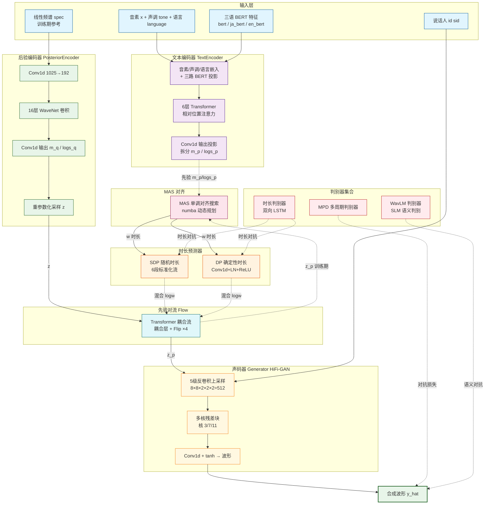

# Bert-VITS2 模型架构、训练与推理科普

面向深度学习入门者的直白指南。本文以 `BookerBV2Tool`（Bert-VITS2 v2.3 声音克隆工具链）为例，把“模型长什么样、怎么训、怎么推”讲清楚。不假设你已有 TTS 背景，只需了解一点点神经网络常识即可阅读。

---

## 一、先说清楚：我们要干什么？

**声音克隆**（Voice Cloning，也叫语音合成 TTS，Text-to-Speech）的目标是：给定一段文本和一个人的声音样本，让机器“用那个人的声音”把文本念出来。

`Bert-VITS2`（下文简称 BV2）是目前较为流行的端到端声音克隆模型之一。它把文本转音频的整个过程，用一个大神经网络一次性学出来，不再需要传统 TTS 里那种“先预测声谱图，再用声码器还原波形”的两阶段拆分。

`BookerBV2Tool` 则是围绕 BV2 做的一整套工具链，把“一段视频/音频”变成“可训练的克隆模型”，再把文本合成语音。它的全流程是：

```mermaid
flowchart LR
    A[视频/音频] -->|(1) slice 按静音切分| B[语音片段 WAV]
    B -->|(2) resample 统一采样率| C[44100 Hz WAV]
    C -->|(3) mark SenseVoice 转写| D[WAV + *.wav.txt]
    D -->|(4) mklist 汇总标注| E[speaker_list.json]
    E -->|(5) preproc 清洗/划分/写配置| F[train/val_list.json + config.json]
    F -->|(6) bert-gen 生成 BERT 特征| G[*_bert.pt 带特征的数据]
    G -->|(7) train 训练模型| H[模型权重 G_*.pth 等]
    H -->|(8) infer 文本转语音| I[合成音频 WAV]

    style A fill:#e1f5fe,stroke:#01579b
    style I fill:#e8f5e9,stroke:#1b5e20
    style H fill:#fff8e1,stroke:#f57f17
```

前六步全是“造数据”，最后两步才是“真正跑模型”。本文重点讲最后三步的核心——模型架构、训练流程、推理流程，同时会简要提一下前面怎么产出训练所需的数据，让你有完整印象。

---

## 二、模型架构：SynthesizerTrn 长什么样？

BV2 的核心模型叫 `SynthesizerTrn`，它是一个 **VITS 风格的条件 VAE + 声码器**。用大白话讲：它既是一个“变分自编码器”（VAE，学习把声音压缩成隐藏变量、再解压出来），又是一个“声码器”（把隐藏变量还原成可听的波形）。模型由 **五大子网络** 组成，外加一组 **判别器** 负责对抗训练，让生出来的声音更真实。

下面是模型的端到端拓扑（用 mermaid 流程图展示）：



### 2.1 输入是什么？

模型一次训练/推理需要一组输入，由数据预处理阶段准备好：

| 输入 | 含义 | 形状（示例） |
|------|------|-------------|
| `x` | 音素 id 序列（词表 112 个音素，pad=0） | `[B, T]` |
| `tone` | 声调 id（含语言偏移） | `[B, T]` |
| `language` | 语言 id（0=中文、1=英文、2=日文） | `[B, T]` |
| `bert / ja_bert / en_bert` | 三语 BERT 音素级特征（各 1024 维） | `[B, 1024, T]` |
| `spec` | 线性频谱（STFT 2048 点 → 1025 频率箱） | `[B, 1025, T']` |
| `y` | 归一化音频波形（`audio / 32768.0`） | `[B, 1, L]` |
| `sid` | 说话人 id | `[B]` |

`T'` 与 `T` 的关系：音频采样率 44100 Hz，帧移 512，所以频谱帧率约 86.1 Hz，即 `T' = L / 512`。一句话里的每个音素，对应若干个频谱帧，模型需要学会这个对齐关系。

### 2.2 文本编码器 TextEncoder

TextEncoder 负责把“要念什么”编码成模型能理解的向量。它的输入是音素、声调、语言，以及三路 BERT 语义特征；输出是文本的隐藏特征 `x` 以及一个先验分布 `N(m_p, logs_p)`。

内部流程大致如此：

1. **嵌入层**：音素嵌入（112→192）、声调嵌入（12→192）、语言嵌入（3→192）；三路 BERT 特征各用一个 `Conv1d(1024→192)` 投影到 192 维。
2. **组合**：把上述所有向量相加，再乘以 `sqrt(192)` 做方差缩放。
3. **Transformer 编码器**：6 层 Transformer，每层包含多头自注意力、前馈网络（FFN），并带残差连接和 LayerNorm。注意力使用的是**相对位置注意力**（窗口大小 4、可学习的相对位置偏置），能更好地捕捉音素之间的局部顺序关系。
4. **说话人条件注入**：如果开启了“说话人条件编码器”，说话人嵌入 `g` 会在第 3 个 Transformer 块处加到特征上，让模型知道“这是谁的声音”。
5. **输出投影**：一个 `Conv1d(192→384)` 把特征拆成 `m_p` 和 `logs_p`，分别表示先验分布的均值和对数标准差。

#### 模块结构图（TextEncoder）

```mermaid
flowchart TB
    subgraph 输入
    x[音素 id x<br/>[B, T]]:::in
    tone[声调 id tone<br/>[B, T]]:::in
    lang[语言 id language<br/>[B, T]]:::in
    bert[中文 BERT bert<br/>[B, 1024, T]]:::in
    ja_bert[日文 BERT ja_bert<br/>[B, 1024, T]]:::in
    en_bert[英文 BERT en_bert<br/>[B, 1024, T]]:::in
    g[说话人条件 g<br/>[B, 512, 1]]:::cond
    end

    subgraph 嵌入与投影
    emb[音素嵌入 emb<br/>nn.Embedding(112, 192)]:::mod
    tone_emb[声调嵌入 tone_emb<br/>nn.Embedding(12, 192)]:::mod
    lang_emb[语言嵌入 language_emb<br/>nn.Embedding(3, 192)]:::mod
    bert_proj[中文 BERT 投影 bert_proj<br/>Conv1d(1024→192)]:::mod
    ja_proj[日文 BERT 投影 ja_bert_proj<br/>Conv1d(1024→192)]:::mod
    en_proj[英文 BERT 投影 en_bert_proj<br/>Conv1d(1024→192)]:::mod
    end

    subgraph Transformer 编码器
    enc[6 层 Transformer Encoder<br/>MultiHeadAttention + FFN + LayerNorm<br/>相对位置注意力 window=4]:::mod
    end

    subgraph 输出投影
    proj[输出投影 proj<br/>Conv1d(192→384)<br/>拆分 m_p / logs_p]:::mod
    end

    x --> emb
    tone --> tone_emb
    lang --> lang_emb
    bert --> bert_proj
    ja_bert --> ja_proj
    en_bert --> en_proj
    emb --> add[全部相加 × sqrt(192)]
    tone_emb --> add
    lang_emb --> add
    bert_proj --> add
    ja_proj --> add
    en_proj --> add
    add --> enc
    g -.->|第 3 块注入<br/>use_spk_conditioned_encoder| enc
    enc --> proj
    proj --> out[m_p / logs_p<br/>[B, 192, T]]:::out

    classDef in fill:#e1f5fe,stroke:#01579b
    classDef mod fill:#f3e5f5,stroke:#4a148c
    classDef cond fill:#fff3e0,stroke:#e65100
    classDef out fill:#e8f5e9,stroke:#1b5e20
```

#### 关键代码（`models.py:471-589`）

```python
class TextEncoder(nn.Module):
    def __init__(
        self,
        n_vocab,
        out_channels,
        hidden_channels,
        filter_channels,
        n_heads,
        n_layers,
        kernel_size,
        p_dropout,
        gin_channels=0,
    ):
        super().__init__()
        # 符号嵌入
        self.emb = nn.Embedding(len(symbols), hidden_channels)
        nn.init.normal_(self.emb.weight, 0.0, hidden_channels**-0.5)

        # 音调嵌入
        self.tone_emb = nn.Embedding(num_tones, hidden_channels)
        nn.init.normal_(self.tone_emb.weight, 0.0, hidden_channels**-0.5)

        # 语言嵌入
        self.language_emb = nn.Embedding(num_languages, hidden_channels)
        nn.init.normal_(self.language_emb.weight, 0.0, hidden_channels**-0.5)

        # BERT 投影层（三语各一路）
        self.bert_proj = nn.Conv1d(1024, hidden_channels, 1)    # 中文
        self.ja_bert_proj = nn.Conv1d(1024, hidden_channels, 1)  # 日文
        self.en_bert_proj = nn.Conv1d(1024, hidden_channels, 1)  # 英文

        # Transformer 编码器
        self.encoder = attentions.Encoder(
            hidden_channels, filter_channels, n_heads, n_layers,
            kernel_size, p_dropout, gin_channels=self.gin_channels,
        )
        # 投影到输出（均值和对数方差）
        self.proj = nn.Conv1d(hidden_channels, out_channels * 2, 1)

    def forward(self, x, x_lengths, tone, language, bert, ja_bert, en_bert, g=None):
        # 投影 BERT 特征 [B, 1024, T] -> [B, T, 192]
        bert_emb = self.bert_proj(bert).transpose(1, 2)
        ja_bert_emb = self.ja_bert_proj(ja_bert).transpose(1, 2)
        en_bert_emb = self.en_bert_proj(en_bert).transpose(1, 2)

        # 组合所有嵌入 [B, T, 192]
        x = (
            self.emb(x)
            + self.tone_emb(tone)
            + self.language_emb(language)
            + bert_emb
            + ja_bert_emb
            + en_bert_emb
        ) * math.sqrt(self.hidden_channels)

        x = torch.transpose(x, 1, -1)  # [B, 192, T]
        x_mask = torch.unsqueeze(
            commons.sequence_mask(x_lengths, x.size(2)), 1
        ).to(x.dtype)

        # Transformer 编码
        x = self.encoder(x * x_mask, x_mask, g=g)
        stats = self.proj(x) * x_mask

        # 分割为均值 m 和对数标准差 logs
        m, logs = torch.split(stats, self.out_channels, dim=1)
        return x, m, logs, x_mask
```

**要点：**
- 三路 BERT 特征**全部相加**（不是按语言选择），所以推理时即使只合成一种语言，另外两路也要喂随机噪声占位。
- 说话人条件 `g` 只在第 3 个 Transformer 块（`i==2`）前加到特征上，实现说话人条件编码。

### 2.3 后验编码器 PosteriorEncoder

训练时，模型需要把“真实音频”压缩成隐藏变量，这就是后验编码器的工作。它吃线性频谱 `spec`，输出后验分布的样本 `z`（以及分布参数 `m_q, logs_q`）。

内部结构：

1. `Conv1d(1025→192)` 把频谱投到 192 维。
2. 16 层 **WaveNet 卷积**（带门控 tanh 单元、扩散卷积、说话人条件通道），逐步提取音频的局部与全局声学特征。
3. `Conv1d(192→384)` 拆成 `m_q, logs_q`。
4. **重参数化采样**：`z = m_q + 随机噪声 × exp(logs_q)`，得到后验样本 `z`。

BV2 默认不使用 mel 频谱作为后验输入，而是直接用线性频谱；mel 只在训练损失里即时计算。

#### 模块结构图（PosteriorEncoder）

```mermaid
flowchart TB
    subgraph 输入
    spec[线性频谱 spec<br/>[B, 1025, T']]:::in
    y_lengths[频谱长度<br/>[B]]:::in
    g[说话人条件 g<br/>[B, 512, 1]]:::cond
    end

    subgraph 编码
    pre[前置投影 pre<br/>Conv1d(1025→192)]:::mod
    enc[16 层 WaveNet 卷积 enc<br/>门控 tanh + 扩散卷积<br/>带说话人条件通道]:::mod
    proj[统计投影 proj<br/>Conv1d(192→384)]:::mod
    end

    subgraph 输出
    split[拆分 m_q / logs_q<br/>各 [B, 192, T']]:::mod
    sample[重参数化采样<br/>z = m_q + randn × exp(logs_q)]:::mod
    end

    spec --> pre
    pre --> enc
    enc --> proj
    proj --> split
    split --> sample
    sample --> out[z 后验样本<br/>[B, 192, T']]:::out
    g -.->|条件通道 cond_layer| enc

    classDef in fill:#e1f5fe,stroke:#01579b
    classDef mod fill:#e8f5e9,stroke:#1b5e20
    classDef cond fill:#fff3e0,stroke:#e65100
    classDef out fill:#e8f5e9,stroke:#1b5e20
```

#### 关键代码（`models.py:652-721`）

```python
class PosteriorEncoder(nn.Module):
    def __init__(
        self,
        in_channels,
        out_channels,
        hidden_channels,
        kernel_size,
        dilation_rate,
        n_layers,
        gin_channels=0,
    ):
        super().__init__()
        # 频谱 -> 隐藏维度
        self.pre = nn.Conv1d(in_channels, hidden_channels, 1)
        # 16 层 WaveNet 卷积（带门控 tanh、扩散卷积、说话人条件）
        self.enc = modules.WN(
            hidden_channels, kernel_size, dilation_rate, n_layers,
            gin_channels=gin_channels,
        )
        # 拆分为后验均值和对数标准差
        self.proj = nn.Conv1d(hidden_channels, out_channels * 2, 1)

    def forward(self, x, x_lengths, g=None):
        # 构造帧掩码 [B, 1, T']
        x_mask = torch.unsqueeze(
            commons.sequence_mask(x_lengths, x.size(2)), 1
        ).to(x.dtype)
        x = self.pre(x) * x_mask
        x = self.enc(x, x_mask, g=g)
        stats = self.proj(x) * x_mask
        m, logs = torch.split(stats, self.out_channels, dim=1)
        # 重参数化技巧采样
        z = (m + torch.randn_like(m) * torch.exp(logs)) * x_mask
        return z, m, logs, x_mask
```

**要点：**
- 输入是**线性频谱**（1025 频率箱），不是 mel 频谱；mel 只在训练损失里即时从线性谱计算。
- WaveNet 有 16 层，参数量较大（约 1050 万），是后验编码器的主体开销。

### 2.4 先验对流 Flow

Flow 是 VAE 中的“可逆变换”。训练时，它把后验样本 `z` 映射到先验空间，得到 `z_p = flow(z)`；推理时，它反过来，把从先验分布采样的 `z_p` 变换回声学隐变量 `z = flow(z_p, reverse=True)`。

BV2 默认使用 **Transformer 耦合流**（Transformer Coupling Flow），共 4 层，每层是“Transformer 耦合层 + Flip”：

- **耦合层**：把通道分成两半，一半保持不变，另一半通过 Transformer 预测一个平移量 `m` 做仿射变换；因为方差恒为 0，每层的 logdet（对行列式对数的贡献）为 0，训练时不需要额外处理。
- **Flip**：把通道顺序反转，打散层间强相关，保证多层耦合的组合足够有表达能力。

（VITS1 风格的 WaveNet 残差耦合流仍可选，但 v2.3 默认用 Transformer 版。）

#### 模块结构图（Flow）

```mermaid
flowchart TB
    subgraph 输入
    z[后验样本 z<br/>[B, 192, T']]:::in
    y_mask[频谱掩码 y_mask<br/>[B, 1, T']]:::in
    g[说话人条件 g<br/>[B, 512, 1]]:::cond
    end

    subgraph 4 层耦合流
    f1[TransformerCouplingLayer 1<br/>+ Flip]:::mod
    f2[TransformerCouplingLayer 2<br/>+ Flip]:::mod
    f3[TransformerCouplingLayer 3<br/>+ Flip]:::mod
    f4[TransformerCouplingLayer 4<br/>+ Flip]:::mod
    end

    subgraph 单层耦合层内部
    split[通道对分割 x0 / x1]:::mod
    pre[Conv1d 平移]:::mod
    enc[Transformer Encoder<br/>isflow=True, 4 层]:::mod
    post[Conv1d 输出 m<br/>mean_only=True]:::mod
    combine[通道拼接 x0 / x1]:::mod
    end

    z --> f1 --> f2 --> f3 --> f4
    f1 --> split
    split --> pre
    pre --> enc
    enc --> post
    post --> combine
    combine --> f1
    g -.->|条件输入| enc

    classDef in fill:#e1f5fe,stroke:#01579b
    classDef mod fill:#e0f7fa,stroke:#006064
    classDef cond fill:#fff3e0,stroke:#e65100
```

#### 关键代码（`models.py:118-210`、`modules.py:519-580`、`modules.py:374-381`）

```python
# --- models.py: TransformerCouplingBlock ---
class TransformerCouplingBlock(nn.Module):
    def __init__(
        self, channels, hidden_channels, filter_channels, n_heads,
        n_layers, kernel_size, p_dropout, n_flows=4,
        gin_channels=0, share_parameter=False,
    ):
        super().__init__()
        self.n_flows = n_flows
        self.gin_channels = gin_channels
        self.flows = nn.ModuleList()

        # 可选：跨层共享 Transformer 参数以节省显存
        self.wn = (
            attentions.FFT(
                hidden_channels, filter_channels, n_heads, n_layers,
                kernel_size, p_dropout, isflow=True,
                gin_channels=self.gin_channels,
            )
            if share_parameter else None
        )

        for i in range(n_flows):
            self.flows.append(
                modules.TransformerCouplingLayer(
                    channels, hidden_channels, kernel_size, n_layers,
                    n_heads, p_dropout, filter_channels,
                    mean_only=True,
                    wn_sharing_parameter=self.wn,
                    gin_channels=self.gin_channels,
                )
            )
            self.flows.append(modules.Flip())  # 通道翻转，打散强相关

    def forward(self, x, x_mask, g=None, reverse=False):
        if not reverse:
            for flow in self.flows:
                x, _ = flow(x, x_mask, g=g, reverse=reverse)
        else:
            for flow in reversed(self.flows):
                x = flow(x, x_mask, g=g, reverse=reverse)
        return x


# --- modules.py: TransformerCouplingLayer ---
class TransformerCouplingLayer(nn.Module):
    def forward(self, x, x_mask, g=None, reverse=False):
        x0, x1 = torch.split(x, [self.half_channels] * 2, 1)
        h = self.pre(x0) * x_mask
        h = self.enc(h, x_mask, g=g)          # Transformer 预测平移量
        stats = self.post(h) * x_mask
        m = stats                              # mean_only=True，logs 恒 0
        logs = torch.zeros_like(m)

        if not reverse:
            x1 = m + x1                        # 正向：x1 = m + x1
            x = torch.cat([x0, x1], 1)
            return x, 0                        # logdet 为 0
        else:
            x1 = (x1 - m)                      # 逆向：x1 = x1 - m
            x = torch.cat([x0, x1], 1)
            return x


# --- modules.py: Flip ---
class Flip(nn.Module):
    def forward(self, x, *args, reverse=False, **kwargs):
        x = torch.flip(x, [1])                 # 通道维度翻转
        if not reverse:
            logdet = torch.zeros(x.size(0)).to(dtype=x.dtype, device=x.device)
            return x, logdet
        else:
            return x
```

**要点：**
- 耦合层是 `mean_only=True` 的仿射耦合：正向 `x1 = m + x1`，逆向 `x1 = x1 - m`，`logs` 恒为 0，因此每层 logdet 为 0。
- `Flip` 把通道顺序反转，使得相邻耦合层作用于不同的通道一半，保证组合足够有表达能力。
- 训练时 `z_p = flow(z)`；推理时 `z = flow(z_p, reverse=True)`。

### 2.5 时长预测器：SDP（随机）+ DP（确定性）

TTS 里最关键的问题之一是**时长**：每个音素该念多久？BV2 同时提供两条预测路径：

- **SDP（StochasticDurationPredictor，随机时长预测器）**：用 6 段标准化流建模时长分布，能输出多样化的时长，让合成语音更自然、不死板。训练时计算负对数似然（NLL）；推理时从标准正态分布采样噪声，逆向流式得到 `logw`。
- **DP（DurationPredictor，确定性时长预测器）**：两层 `Conv1d + LayerNorm + ReLU`，输出确定性的 `logw`，更快、更稳定，但缺乏多样性。

训练时两者都用真实时长 `w`（由 MAS 对齐算出）做 MSE 回归，SDP 还有额外的 NLL 项。推理时按 `sdp_ratio` 混合：

```
logw = SDP_逆向采样 × sdp_ratio + DP × (1 - sdp_ratio)
```

默认 `sdp_ratio = 0.2`，即主要用确定性 DP，掺一点随机 SDP 增加自然度。

#### 模块结构图（时长预测器）

```mermaid
flowchart TB
    subgraph 输入
    x[文本隐藏特征 x<br/>[B, 192, T]]:::in
    x_mask[文本掩码 x_mask<br/>[B, 1, T]]:::in
    g[说话人条件 g<br/>[B, 512, 1]]:::cond
    w[真实时长 w<br/>仅训练期]:::in
    end

    subgraph SDP 随机时长预测器
    sdp_pre[pre Conv1d]:::mod
    sdp_convs[DDSConv 3 层]:::mod
    sdp_proj[proj Conv1d]:::mod
    sdp_flows[6 段标准化流<br/>ElementwiseAffine + ConvFlow + Flip]:::mod
    sdp_log_flow[Log 流]:::mod
    end

    subgraph DP 确定性时长预测器
    dp_conv1[Conv1d + ReLU + LayerNorm]:::mod
    dp_conv2[Conv1d + ReLU + LayerNorm]:::mod
    dp_proj[Conv1d → 1]:::mod
    end

    subgraph 输出
    logw[对数时长 logw<br/>[B, 1, T]]:::out
    end

    x --> sdp_pre --> sdp_convs --> sdp_proj
    sdp_proj --> sdp_flows
    sdp_flows --> sdp_log_flow
    sdp_log_flow --> logw
    x --> dp_conv1 --> dp_conv2 --> dp_proj --> logw
    w -.->|训练期监督| sdp_flows
    w -.->|训练期监督| dp_proj
    g -.->|条件输入| sdp_proj
    g -.->|条件输入| dp_conv1

    classDef in fill:#e1f5fe,stroke:#01579b
    classDef mod fill:#fff3e0,stroke:#e65100
    classDef cond fill:#ffe0b2,stroke:#bf360c
    classDef out fill:#e8f5e9,stroke:#1b5e20
```

#### 关键代码（`models.py:213-349` SDP、`models.py:352-416` DP）

```python
# --- StochasticDurationPredictor（随机，6 段标准化流）---
class StochasticDurationPredictor(nn.Module):
    def __init__(self, in_channels, filter_channels, kernel_size,
                 p_dropout, n_flows=4, gin_channels=0):
        super().__init__()
        self.log_flow = modules.Log()
        self.flows = nn.ModuleList()
        self.flows.append(modules.ElementwiseAffine(2))
        for i in range(n_flows):
            self.flows.append(
                modules.ConvFlow(2, filter_channels, kernel_size, n_layers=3)
            )
            self.flows.append(modules.Flip())

        # 后验构造网络（训练期用）
        self.post_pre = nn.Conv1d(1, filter_channels, 1)
        self.post_proj = nn.Conv1d(filter_channels, filter_channels, 1)
        self.post_convs = modules.DDSConv(
            filter_channels, kernel_size, n_layers=3, p_dropout=p_dropout
        )
        self.post_flows = nn.ModuleList()
        self.post_flows.append(modules.ElementwiseAffine(2))
        for i in range(4):
            self.post_flows.append(
                modules.ConvFlow(2, filter_channels, kernel_size, n_layers=3)
            )
            self.post_flows.append(modules.Flip())

        # 前置特征编码
        self.pre = nn.Conv1d(in_channels, filter_channels, 1)
        self.proj = nn.Conv1d(filter_channels, filter_channels, 1)
        self.convs = modules.DDSConv(
            filter_channels, kernel_size, n_layers=3, p_dropout=p_dropout
        )
        if gin_channels != 0:
            self.cond = nn.Conv1d(gin_channels, filter_channels, 1)

    def forward(self, x, x_mask, w=None, g=None, reverse=False, noise_scale=1.0):
        x = torch.detach(x)
        x = self.pre(x)
        if g is not None:
            x = x + self.cond(g)
        x = self.convs(x, x_mask)
        x = self.proj(x) * x_mask

        if not reverse:
            # 训练：对真实时长 w 计算负对数似然（NLL）
            ...
            return nll + logq
        else:
            # 推理：从标准正态噪声逆向流式生成 logw
            flows = list(reversed(self.flows))
            flows = flows[:-2] + [flows[-1]]  # 去掉冗余的 vflow
            z = torch.randn(x.size(0), 2, x.size(2)) * noise_scale
            for flow in flows:
                z = flow(z, x_mask, g=x, reverse=reverse)
            z0, z1 = torch.split(z, [1, 1], 1)
            logw = z0
            return logw


# --- DurationPredictor（确定性，两层卷积）---
class DurationPredictor(nn.Module):
    def __init__(self, in_channels, filter_channels, kernel_size,
                 p_dropout, gin_channels=0):
        super().__init__()
        self.drop = nn.Dropout(p_dropout)
        self.conv_1 = nn.Conv1d(
            in_channels, filter_channels, kernel_size, padding=kernel_size // 2
        )
        self.norm_1 = modules.LayerNorm(filter_channels)
        self.conv_2 = nn.Conv1d(
            filter_channels, filter_channels, kernel_size, padding=kernel_size // 2
        )
        self.norm_2 = modules.LayerNorm(filter_channels)
        self.proj = nn.Conv1d(filter_channels, 1, 1)
        if gin_channels != 0:
            self.cond = nn.Conv1d(gin_channels, in_channels, 1)

    def forward(self, x, x_mask, g=None):
        x = torch.detach(x)
        if g is not None:
            x = x + self.cond(g)
        x = self.conv_1(x * x_mask)
        x = torch.relu(x)
        x = self.norm_1(x)
        x = self.drop(x)
        x = self.conv_2(x * x_mask)
        x = torch.relu(x)
        x = self.norm_2(x)
        x = self.drop(x)
        x = self.proj(x * x_mask)
        return x * x_mask
```

**要点：**
- SDP 用标准化流建模时长分布，训练时计算 NLL，推理时从噪声逆向采样得到 `logw`，能产生多样化时长。
- DP 是两层 `Conv1d + LayerNorm + ReLU`，输出确定性 `logw`，更快更稳但缺乏多样性。
- 推理时按 `sdp_ratio` 混合：`logw = SDP × sdp_ratio + DP × (1 - sdp_ratio)`。

### 2.6 MAS：单调对齐搜索（Monotonic Alignment Search）

训练时模型需要知道“第 i 个音素对应频谱的哪几帧”。BV2 使用 **MAS 算法**：基于先验分布与后验样本构造负交叉熵打分矩阵，然后用 numba JIT 加速的动态规划，在“严格单调”约束下找出最优对齐路径。单调意味着：音素按顺序依次对应频谱帧，不会出现“先念第 3 个音素又回头念第 1 个”这种情况，这正是人说话的自然规律。

得到对齐矩阵 `attn` 后，每个音素的时长 `w = attn.sum(2)`，作为时长预测器的监督信号。

#### MAS 算法流程图

```mermaid
flowchart TB
    subgraph 输入
    m_p[先验均值 m_p<br/>[B, 192, T_s]]:::in
    logs_p[先验对数标准差 logs_p<br/>[B, 192, T_s]]:::in
    z_p[先验流输出 z_p<br/>[B, 192, T_t]]:::in
    x_mask[文本掩码]:::in
    y_mask[频谱掩码]:::in
    end

    subgraph 构造负交叉熵打分矩阵 neg_cent
    s_p_sq_r[exp(-2 × logs_p)]:::mod
    neg_cent1[-0.5 × log(2π) - logs_p]:::mod
    neg_cent2[-0.5 × z_p² · s_p_sq_r]:::mod
    neg_cent3[z_p · (m_p × s_p_sq_r)]:::mod
    neg_cent4[-0.5 × m_p² × s_p_sq_r]:::mod
    end

    subgraph 可选噪声缩放
    noise[高斯噪声 ε<br/>噪声随步数线性衰减]:::mod
    end

    subgraph 单调动态规划（numba JIT）
    max_path[maximum_path<br/>value[y,x] += max(prev_cur, prev_up)<br/>严格单调 x ≥ y]:::mod
    end

    subgraph 输出
    attn[对齐矩阵 attn<br/>[B, 1, T_s, T_t]]:::out
    w[音素时长 w = attn.sum(2)<br/>[B, T_s]]:::out
    end

    m_p --> s_p_sq_r
    logs_p --> s_p_sq_r
    s_p_sq_r --> neg_cent2
    s_p_sq_r --> neg_cent3
    s_p_sq_r --> neg_cent4
    z_p --> neg_cent2
    z_p --> neg_cent3
    m_p --> neg_cent3
    m_p --> neg_cent4
    neg_cent1 --> sum[neg_cent = 总和]:::mod
    neg_cent2 --> sum
    neg_cent3 --> sum
    neg_cent4 --> sum
    sum --> noise
    noise --> max_path
    x_mask --> mask[attn_mask = x_mask ⊗ y_mask<br/>屏蔽无效位置]:::mod
    y_mask --> mask
    mask --> max_path
    max_path --> attn
    attn --> w

    classDef in fill:#e1f5fe,stroke:#01579b
    classDef mod fill:#fce4ec,stroke:#880e4f
    classDef out fill:#e8f5e9,stroke:#1b5e20
```

**要点：**
- MAS 基于先验分布与后验样本构造负交叉熵打分矩阵 `neg_cent`，在“严格单调”约束下用 numba JIT 动态规划求最优对齐路径。
- 单调意味着音素按顺序依次对应频谱帧，符合人说话的自然规律。
- 开启 `use_noise_scaled_mas` 时，在打分上加随机高斯噪声，噪声幅度随训练步数线性衰减，实现“随机对齐”提升鲁棒性。

### 2.7 声码器 Generator（HiFi-GAN）

有了声学隐变量 `z`（帧率约 86 Hz），Generator 负责把它“放大”回 44.1 kHz 的原始波形。它基于 HiFi-GAN：

1. **上采样**：5 级反卷积（`ConvTranspose1d`），倍率分别是 8、8、2、2、2，总倍数 512，正好对应帧移 512。通道数从 512 逐级减半到 32。
2. **多核残差块**：每级上采样前接 3 个不同卷积核（3、7、11）的残差块，把三路输出求平均，捕获不同尺度的声学细节。
3. **说话人条件**：说话人嵌入 `g` 投影后加到第一个上采样层的输入上。
4. **输出**：`Conv1d(ch, 1, 7)` + `tanh`，得到最终波形 `y_hat`，取值范围 [-1, 1]。

#### 模块结构图（Generator / HiFi-GAN）

```mermaid
flowchart TB
    subgraph 输入
    z[声学隐变量 z<br/>[B, 192, T']]:::in
    g[说话人条件 g<br/>[B, 512, 1]]:::cond
    end

    subgraph 初始投影
    conv_pre[conv_pre<br/>Conv1d(192→512, k=7)]:::mod
    end

    subgraph 5 级上采样 + 残差块
    up1[上采样 1 ×8<br/>ConvTranspose1d<br/>+ LeakyReLU]:::mod
    res1[残差块核 3/7/11<br/>输出求平均]:::mod
    up2[上采样 2 ×8<br/>ConvTranspose1d<br/>+ LeakyReLU]:::mod
    res2[残差块核 3/7/11<br/>输出求平均]:::mod
    up3[上采样 3 ×2<br/>ConvTranspose1d<br/>+ LeakyReLU]:::mod
    res3[残差块核 3/7/11<br/>输出求平均]:::mod
    up4[上采样 4 ×2<br/>ConvTranspose1d<br/>+ LeakyReLU]:::mod
    res4[残差块核 3/7/11<br/>输出求平均]:::mod
    up5[上采样 5 ×2<br/>ConvTranspose1d<br/>+ LeakyReLU]:::mod
    res5[残差块核 3/7/11<br/>输出求平均]:::mod
    end

    subgraph 输出
    conv_post[conv_post<br/>Conv1d(ch→1, k=7)<br/>+ tanh]:::mod
    end

    z --> conv_pre
    g -.->|加到第一个上采样输入| conv_pre
    conv_pre --> up1 --> res1 --> up2 --> res2 --> up3 --> res3 --> up4 --> res4 --> up5 --> res5
    res5 --> conv_post
    conv_post --> out[波形 y_hat<br/>[B, 1, L]]:::out

    classDef in fill:#e1f5fe,stroke:#01579b
    classDef mod fill:#fff8e1,stroke:#f57f17
    classDef cond fill:#ffe0b2,stroke:#bf360c
    classDef out fill:#e8f5e9,stroke:#1b5e20
```

#### 关键代码（`models.py:724-820`、`modules.py:221-309`）

```python
# --- Generator（HiFi-GAN 声码器）---
class Generator(torch.nn.Module):
    def __init__(
        self, initial_channel, resblock, resblock_kernel_sizes,
        resblock_dilation_sizes, upsample_rates, upsample_initial_channel,
        upsample_kernel_sizes, gin_channels=0,
    ):
        super(Generator, self).__init__()
        self.num_kernels = len(resblock_kernel_sizes)
        self.num_upsamples = len(upsample_rates)

        # 初始卷积
        self.conv_pre = Conv1d(
            initial_channel, upsample_initial_channel, 7, 1, padding=3
        )
        resblock = modules.ResBlock1 if resblock == "1" else modules.ResBlock2

        # 5 级反卷积上采样：8, 8, 2, 2, 2（总倍率 512）
        self.ups = nn.ModuleList()
        for i, (u, k) in enumerate(zip(upsample_rates, upsample_kernel_sizes)):
            self.ups.append(
                weight_norm(
                    ConvTranspose1d(
                        upsample_initial_channel // (2 ** i),
                        upsample_initial_channel // (2 ** (i + 1)),
                        k, u, padding=(k - u) // 2,
                    )
                )
            )

        # 多核残差块（3 个核：3, 7, 11）
        self.resblocks = nn.ModuleList()
        for i in range(len(self.ups)):
            ch = upsample_initial_channel // (2 ** (i + 1))
            for j, (k, d) in enumerate(zip(resblock_kernel_sizes, resblock_dilation_sizes)):
                self.resblocks.append(resblock(ch, k, d))

        # 输出：tanh 压到 [-1, 1]
        self.conv_post = Conv1d(ch, 1, 7, 1, padding=3, bias=False)
        self.ups.apply(init_weights)

        if gin_channels != 0:
            self.cond = nn.Conv1d(gin_channels, upsample_initial_channel, 1)

    def forward(self, x, g=None):
        x = self.conv_pre(x)
        if g is not None:
            x = x + self.cond(g)  # 说话人条件注入

        for i in range(self.num_upsamples):
            x = F.leaky_relu(x, modules.LRELU_SLOPE)  # slope=0.1
            x = self.ups[i](x)
            xs = None
            for j in range(self.num_kernels):
                if xs is None:
                    xs = self.resblocks[i * self.num_kernels + j](x)
                else:
                    xs += self.resblocks[i * self.num_kernels + j](x)
            x = xs / self.num_kernels  # 多核输出求平均
        x = F.leaky_relu(x)
        x = self.conv_post(x)
        x = torch.tanh(x)
        return x
```

**要点：**
- 5 级反卷积倍率 `8×8×2×2×2 = 512`，正好对应帧移 512，把 ~86 Hz 的隐变量还原到 44.1 kHz 波形。
- 每级上采样前接 3 个不同卷积核（3、7、11）的 `ResBlock1`，三路输出求平均，捕获多尺度声学细节。
- 推理时可调用 `remove_weight_norm()` 加速。

### 2.8 判别器集合：让声音更真实

BV2 采用对抗训练，生成器试图“骗过”判别器，判别器试图分辨真假。一共三类判别器：

| 判别器 | 作用 | 结构特点 |
|--------|------|---------|
| **MPD**（多周期判别器） | 分辨真实/生成波形 | 1 个尺度判别器 + 5 个周期判别器（period ∈ {2,3,5,7,11}），捕获基频等周期结构 |
| **时长判别器**（VITS2 特色） | 判别预测时长是否真实 | 双向 LSTM，对 SDP 和 DP 分别施加对抗损失 |
| **WavLM 判别器**（SLM） | 语义层面判别 | 用 WavLM 的 13 层隐藏状态（9984 维）做特征，判别生成语音的语义是否匹配 |

判别器同时返回中间特征图 `fmap`，用于**特征匹配损失**，让生成器不仅在“最终判别”上骗过判别器，在中间特征上也要和真实音频一致。

#### 模块结构图（判别器集合）

```mermaid
flowchart TB
    subgraph 输入
    y[真实音频 y<br/>[B, 1, L]]:::in
    y_hat[生成音频 y_hat<br/>[B, 1, L]]:::in
    end

    subgraph MPD 多周期判别器
    discS[DiscriminatorS<br/>1D 卷积<br/>16→64→256→1024→1]:::mod
    discP2[DiscriminatorP period=2]:::mod
    discP3[DiscriminatorP period=3]:::mod
    discP5[DiscriminatorP period=5]:::mod
    discP7[DiscriminatorP period=7]:::mod
    discP11[DiscriminatorP period=11]:::mod
    end

    subgraph 时长判别器 DUR（VITS2 特色）
    dur_lstm[双向 LSTM<br/>2 层卷积 + dur_proj<br/>→ Sigmoid]:::mod
    end

    subgraph WavLM 判别器 WD（SLM）
    wavlm_pre[Conv1d(9984→64)<br/>13 层 WavLM 隐藏态堆叠]:::mod
    wavlm_conv[3 层 Conv1d<br/>64→128→256→256]:::mod
    wavlm_post[Conv1d→1 Logit]:::mod
    end

    subgraph 输出
    d_r[真实分数]:::out
    d_g[生成分数]:::out
    fmap[特征图 fmap<br/>用于特征匹配损失]:::out
    end

    y --> discS
    y_hat --> discS
    y --> discP2
    y_hat --> discP2
    y --> discP3
    y_hat --> discP3
    y --> discP5
    y_hat --> discP5
    y --> discP7
    y_hat --> discP7
    y --> discP11
    y_hat --> discP11
    discS --> d_r
    discS --> d_g
    discS --> fmap
    discP2 --> d_r
    discP3 --> d_r
    discP5 --> d_r
    discP7 --> d_r
    discP11 --> d_r
    discP2 --> d_g
    discP3 --> d_g
    discP5 --> d_g
    discP7 --> d_g
    discP11 --> d_g
    discP2 --> fmap
    discP3 --> fmap
    discP5 --> fmap
    discP7 --> fmap
    discP11 --> fmap

    y --> dur_lstm
    y_hat --> dur_lstm
    dur_lstm --> d_r
    dur_lstm --> d_g

    y --> wavlm_pre
    y_hat --> wavlm_pre
    wavlm_pre --> wavlm_conv --> wavlm_post
    wavlm_post --> d_r
    wavlm_post --> d_g

    classDef in fill:#e1f5fe,stroke:#01579b
    classDef mod fill:#ffebee,stroke:#b71c1c
    classDef out fill:#e8f5e9,stroke:#1b5e20
```

#### 关键代码（`models.py:981-1094`）

```python
# --- MultiPeriodDiscriminator（MPD）---
class MultiPeriodDiscriminator(torch.nn.Module):
    def __init__(self, use_spectral_norm=False):
        super().__init__()
        periods = [2, 3, 5, 7, 11]
        discs = [DiscriminatorS(use_spectral_norm=use_spectral_norm)]
        discs += [DiscriminatorP(i, use_spectral_norm=use_spectral_norm) for i in periods]
        self.discriminators = nn.ModuleList(discs)

    def forward(self, y, y_hat):
        y_d_rs, y_d_gs, fmap_rs, fmap_gs = [], [], [], []
        for d in self.discriminators:
            y_d_r, fmap_r = d(y)
            y_d_g, fmap_g = d(y_hat)
            y_d_rs.append(y_d_r)
            y_d_gs.append(y_d_g)
            fmap_rs.append(fmap_r)
            fmap_gs.append(fmap_g)
        return y_d_rs, y_d_gs, fmap_rs, fmap_gs


# --- DiscriminatorP（周期判别器）---
class DiscriminatorP(torch.nn.Module):
    def __init__(self, period, kernel_size=5, stride=3, use_spectral_norm=False):
        super().__init__()
        self.period = period
        norm_f = weight_norm if not use_spectral_norm else spectral_norm
        self.convs = nn.ModuleList([
            norm_f(Conv2d(1, 32, (kernel_size, 1), (stride, 1), padding=(get_padding(kernel_size, 1), 0))),
            norm_f(Conv2d(32, 128, (kernel_size, 1), (stride, 1), padding=(get_padding(kernel_size, 1), 0))),
            norm_f(Conv2d(128, 512, (kernel_size, 1), (stride, 1), padding=(get_padding(kernel_size, 1), 0))),
            norm_f(Conv2d(512, 1024, (kernel_size, 1), (stride, 1), padding=(get_padding(kernel_size, 1), 0))),
            norm_f(Conv2d(1024, 1024, (kernel_size, 1), 1, padding=(get_padding(kernel_size, 1), 0))),
        ])
        self.conv_post = norm_f(Conv2d(1024, 1, (3, 1), 1, padding=(1, 0)))

    def forward(self, x):
        fmap = []
        b, c, t = x.shape
        if t % self.period != 0:
            n_pad = self.period - (t % self.period)
            x = F.pad(x, (0, n_pad), "reflect")
            t = t + n_pad
        # 1D 转 2D：按周期分块 [B, 1, T/period, period]
        x = x.view(b, c, t // self.period, self.period)
        for layer in self.convs:
            x = layer(x)
            x = F.leaky_relu(x, modules.LRELU_SLOPE)
            fmap.append(x)
        x = self.conv_post(x)
        fmap.append(x)
        x = torch.flatten(x, 1, -1)
        return x, fmap


# --- DiscriminatorS（尺度判别器）---
class DiscriminatorS(torch.nn.Module):
    def __init__(self, use_spectral_norm=False):
        super().__init__()
        norm_f = weight_norm if not use_spectral_norm else spectral_norm
        self.convs = nn.ModuleList([
            norm_f(Conv1d(1, 16, 15, 1, padding=7)),
            norm_f(Conv1d(16, 64, 41, 4, groups=4, padding=20)),
            norm_f(Conv1d(64, 256, 41, 4, groups=16, padding=20)),
            norm_f(Conv1d(256, 1024, 41, 4, groups=64, padding=20)),
            norm_f(Conv1d(1024, 1024, 41, 4, groups=256, padding=20)),
            norm_f(Conv1d(1024, 1024, 5, 1, padding=2)),
        ])
        self.conv_post = norm_f(Conv1d(1024, 1, 3, 1, padding=1))

    def forward(self, x):
        fmap = []
        for layer in self.convs:
            x = layer(x)
            x = F.leaky_relu(x, modules.LRELU_SLOPE)
            fmap.append(x)
        x = self.conv_post(x)
        fmap.append(x)
        x = torch.flatten(x, 1, -1)
        return x, fmap


# --- DurationDiscriminator（VITS2 时长判别器）---
class DurationDiscriminator(nn.Module):
    def __init__(self, in_channels, filter_channels, kernel_size, p_dropout, gin_channels=0):
        super().__init__()
        self.drop = nn.Dropout(p_dropout)
        self.conv_1 = nn.Conv1d(in_channels, filter_channels, kernel_size, padding=kernel_size // 2)
        self.norm_1 = modules.LayerNorm(filter_channels)
        self.conv_2 = nn.Conv1d(filter_channels, filter_channels, kernel_size, padding=kernel_size // 2)
        self.norm_2 = modules.LayerNorm(filter_channels)
        self.dur_proj = nn.Conv1d(1, filter_channels, 1)
        self.LSTM = nn.LSTM(2 * filter_channels, filter_channels, batch_first=True, bidirectional=True)
        if gin_channels != 0:
            self.cond = nn.Conv1d(gin_channels, in_channels, 1)
        self.output_layer = nn.Sequential(nn.Linear(2 * filter_channels, 1), nn.Sigmoid())

    def forward(self, x, x_mask, dur_r, dur_hat, g=None):
        x = torch.detach(x)
        if g is not None:
            x = x + self.cond(g)
        x = self.conv_1(x * x_mask)
        x = torch.relu(x)
        x = self.norm_1(x)
        x = self.drop(x)
        x = self.conv_2(x * x_mask)
        x = torch.relu(x)
        x = self.norm_2(x)
        x = self.drop(x)
        output_probs = []
        for dur in [dur_r, dur_hat]:
            dur_proj = self.dur_proj(dur)
            x_cat = torch.cat([x, dur_proj], dim=1).transpose(1, 2)
            x_lstm, _ = self.LSTM(x_cat)
            output_prob = self.output_layer(x_lstm)
            output_probs.append(output_prob)
        return output_probs


# --- WavLMDiscriminator（SLM 语义判别器）---
class WavLMDiscriminator(nn.Module):
    def __init__(self, slm_hidden=768, slm_layers=13, initial_channel=64, use_spectral_norm=False):
        super().__init__()
        norm_f = weight_norm if not use_spectral_norm else spectral_norm
        self.pre = norm_f(Conv1d(slm_hidden * slm_layers, initial_channel, 1, 1, padding=0))
        self.convs = nn.ModuleList([
            norm_f(nn.Conv1d(initial_channel, initial_channel * 2, 5, padding=2)),
            norm_f(nn.Conv1d(initial_channel * 2, initial_channel * 4, 5, padding=2)),
            norm_f(nn.Conv1d(initial_channel * 4, initial_channel * 4, 5, 1, padding=2)),
        ])
        self.conv_post = norm_f(Conv1d(initial_channel * 4, 1, 3, 1, padding=1))

    def forward(self, x):
        x = self.pre(x)
        fmap = []
        for l in self.convs:
            x = l(x)
            x = F.leaky_relu(x, modules.LRELU_SLOPE)
            fmap.append(x)
        x = self.conv_post(x)
        x = torch.flatten(x, 1, -1)
        return x
```

**要点：**
- MPD 包含 1 个尺度判别器（1D 卷积）+ 5 个周期判别器（2D 卷积，period ∈ {2,3,5,7,11}），捕获不同尺度和周期结构。
- 时长判别器用双向 LSTM 对真实/预测时长分别打分，训练 SDP 和 DP 各自被鉴别。
- WavLM 判别器把 WavLM 13 层隐藏态（9984 维）堆叠后经过卷积判别语义一致性。
- 每个判别器都返回中间特征图 `fmap`，用于生成器的特征匹配损失。

### 2.9 模型参数量

默认 v2.3 配置下，模型各部分参数量如下（不含冻结的外部 BERT/WavLM 本体）：

| 组件 | 参数量 |
|------|--------|
| 说话人嵌入 `emb_g` | 435,200 |
| 文本编码器 `enc_p` | 7,005,888 |
| 后验编码器 `enc_q` | 10,494,336 |
| Transformer 耦合流 `flow` | 26,562,432 |
| 随机时长预测 `sdp` | 1,415,664 |
| 确定时长预测 `dp` | 444,353 |
| HiFi-GAN 生成器 `dec` | 14,662,144 |
| **SynthesizerTrn 合计** | **61,020,017** |
| 多周期判别器 MPD | 46,747,132 |
| 时长判别器 DUR | 1,209,409 |
| WavLM 判别器 WD | 1,173,634 |
| **全集训练参数量** | **110,150,192** |

约 6100 万参数的生成器，加上判别器后全集约 1.1 亿参数。这在今天的大模型眼里并不算大，正正因此可以在单卡甚至 CPU 上训练和推理。

#### SynthesizerTrn 总览：初始化与前向

```mermaid
flowchart TB
    subgraph 初始化 __init__
    emb_g[说话人嵌入 emb_g<br/>nn.Embedding(n_speakers, gin_channels)]:::mod
    enc_p[TextEncoder 文本编码器]:::mod
    dec[Generator HiFi-GAN 声码器]:::mod
    enc_q[PosteriorEncoder 后验编码器]:::mod
    flow[TransformerCouplingBlock 先验对流]:::mod
    sdp[StochasticDurationPredictor 随机时长]:::mod
    dp[DurationPredictor 确定性时长]:::mod
    end

    subgraph 训练前向 forward
    g[获取说话人嵌入 g]:::mod
    enc_p_fwd[enc_p → x, m_p, logs_p, x_mask]:::mod
    enc_q_fwd[enc_q → z, m_q, logs_q, y_mask]:::mod
    flow_fwd[flow(z) → z_p]:::mod
    mas[MAS 单调对齐 → attn, w]:::mod
    sdp_fwd[SDP NLL + 时长 MSE]:::mod
    dp_fwd[DP 时长 MSE]:::mod
    align[attn 铺开 m_p/logs_p 到频谱帧]:::mod
    slice[随机切片 z_slice]:::mod
    dec_fwd[dec(z_slice, g) → o]:::mod
    end

    subgraph 推理前向 infer
    enc_p_inf[enc_p → m_p/logs_p]:::mod
    dur_inf[SDP/DP 混合 → logw → w_ceil]:::mod
    path[generate_path → attn]:::mod
    align_inf[attn 铺开先验]:::mod
    sample[先验采样 z_p = m_p + randn×exp(logs_p)×noise_scale]:::mod
    flow_rev[flow(z_p, reverse=True) → z]:::mod
    dec_inf[dec(z × y_mask, g) → 波形]:::mod
    end

    emb_g --> g
    enc_p --> enc_p_fwd
    enc_q --> enc_q_fwd
    flow --> flow_fwd
    sdp --> sdp_fwd
    dp --> dp_fwd
    dec --> dec_fwd
    dec --> dec_inf

    classDef mod fill:#f3e5f5,stroke:#4a148c
```

#### 关键代码（`models.py:1171-1528`）

```python
class SynthesizerTrn(nn.Module):
    def __init__(
        self, n_vocab, spec_channels, segment_size,
        inter_channels, hidden_channels, filter_channels, n_heads, n_layers,
        kernel_size, p_dropout, resblock, resblock_kernel_sizes,
        resblock_dilation_sizes, upsample_rates, upsample_initial_channel,
        upsample_kernel_sizes, n_speakers=256, gin_channels=256,
        use_sdp=True, n_flow_layer=4, n_layers_trans_flow=4,
        flow_share_parameter=False, use_transformer_flow=True, **kwargs,
    ):
        super().__init__()
        # ... 超参数赋值 ...
        self.use_spk_conditioned_encoder = kwargs.get("use_spk_conditioned_encoder", True)
        self.use_sdp = use_sdp
        self.use_noise_scaled_mas = kwargs.get("use_noise_scaled_mas", False)
        self.mas_noise_scale_initial = kwargs.get("mas_noise_scale_initial", 0.01)
        self.noise_scale_delta = kwargs.get("noise_scale_delta", 2e-6)
        self.current_mas_noise_scale = self.mas_noise_scale_initial
        self.enc_gin_channels = gin_channels if (self.use_spk_conditioned_encoder and gin_channels > 0) else 0

        # 五大子网络
        self.enc_p = TextEncoder(
            n_vocab, inter_channels, hidden_channels, filter_channels,
            n_heads, n_layers, kernel_size, p_dropout,
            gin_channels=self.enc_gin_channels,
        )
        self.dec = Generator(
            inter_channels, resblock, resblock_kernel_sizes,
            resblock_dilation_sizes, upsample_rates,
            upsample_initial_channel, upsample_kernel_sizes,
            gin_channels=gin_channels,
        )
        self.enc_q = PosteriorEncoder(
            spec_channels, inter_channels, hidden_channels,
            5, 1, 16, gin_channels=gin_channels,
        )
        if use_transformer_flow:
            self.flow = TransformerCouplingBlock(
                inter_channels, hidden_channels, filter_channels,
                n_heads, n_layers_trans_flow, 5, p_dropout,
                n_flow_layer, gin_channels=gin_channels,
                share_parameter=flow_share_parameter,
            )
        else:
            self.flow = ResidualCouplingBlock(
                inter_channels, hidden_channels, 5, 1,
                n_flow_layer, gin_channels=gin_channels,
            )
        self.sdp = StochasticDurationPredictor(
            hidden_channels, 192, 3, 0.5, 4, gin_channels=gin_channels,
        )
        self.dp = DurationPredictor(
            hidden_channels, 256, 3, 0.5, gin_channels=gin_channels,
        )
        # 说话人嵌入或参考编码器（零样本模式）
        if n_speakers >= 1:
            self.emb_g = nn.Embedding(n_speakers, gin_channels)
        else:
            self.ref_enc = ReferenceEncoder(spec_channels, gin_channels)

    def forward(self, x, x_lengths, y, y_lengths, sid, tone, language,
                bert, ja_bert, en_bert):
        # 说话人嵌入
        if self.n_speakers > 0:
            g = self.emb_g(sid).unsqueeze(-1)  # [B, gin_channels, 1]
        else:
            g = self.ref_enc(y.transpose(1, 2)).unsqueeze(-1)

        # 文本编码 → 先验分布
        x, m_p, logs_p, x_mask = self.enc_p(x, x_lengths, tone, language,
                                            bert, ja_bert, en_bert, g=g)
        # 后验编码 → 后验样本
        z, m_q, logs_q, y_mask = self.enc_q(y, y_lengths, g=g)
        z_p = self.flow(z, y_mask, g=g)

        # MAS 单调对齐（无梯度）
        with torch.no_grad():
            s_p_sq_r = torch.exp(-2 * logs_p)
            neg_cent1 = torch.sum(-0.5 * math.log(2 * math.pi) - logs_p, [1], keepdim=True)
            neg_cent2 = torch.matmul(-0.5 * (z_p**2).transpose(1, 2), s_p_sq_r)
            neg_cent3 = torch.matmul(z_p.transpose(1, 2), (m_p * s_p_sq_r))
            neg_cent4 = torch.sum(-0.5 * (m_p**2) * s_p_sq_r, [1], keepdim=True)
            neg_cent = neg_cent1 + neg_cent2 + neg_cent3 + neg_cent4
            if self.use_noise_scaled_mas:
                epsilon = torch.std(neg_cent) * torch.randn_like(neg_cent) * self.current_mas_noise_scale
                neg_cent = neg_cent + epsilon
            attn_mask = torch.unsqueeze(x_mask, 2) * torch.unsqueeze(y_mask, -1)
            attn = monotonic_align.maximum_path(neg_cent, attn_mask.squeeze(1)).unsqueeze(1).detach()

        # 对齐后的时长
        w = attn.sum(2)

        # 时长损失
        l_length_sdp = self.sdp(x, x_mask, w, g=g) / torch.sum(x_mask)
        logw_ = torch.log(w + 1e-6) * x_mask
        logw = self.dp(x, x_mask, g=g)
        logw_sdp = self.sdp(x, x_mask, g=g, reverse=True, noise_scale=1.0)
        l_length_dp = torch.sum((logw - logw_) ** 2, [1, 2]) / torch.sum(x_mask)
        l_length_sdp += torch.sum((logw_sdp - logw_) ** 2, [1, 2]) / torch.sum(x_mask)
        l_length = l_length_dp + l_length_sdp

        # 根据对齐扩展先验到频谱帧
        m_p = torch.matmul(attn.squeeze(1), m_p.transpose(1, 2)).transpose(1, 2)
        logs_p = torch.matmul(attn.squeeze(1), logs_p.transpose(1, 2)).transpose(1, 2)

        # 随机切片 + 生成器解码
        z_slice, ids_slice = commons.rand_slice_segments(z, y_lengths, self.segment_size)
        o = self.dec(z_slice, g=g)
        return (o, l_length, attn, ids_slice, x_mask, y_mask,
                (z, z_p, m_p, logs_p, m_q, logs_q),
                (x, logw, logw_, logw_sdp), g)

    def infer(self, x, x_lengths, sid, tone, language, bert, ja_bert, en_bert,
              noise_scale=0.667, length_scale=1, noise_scale_w=0.8,
              max_len=None, sdp_ratio=0, y=None):
        # 说话人嵌入
        if self.n_speakers > 0:
            g = self.emb_g(sid).unsqueeze(-1)
        else:
            g = self.ref_enc(y.transpose(1, 2)).unsqueeze(-1)

        # 文本编码
        x, m_p, logs_p, x_mask = self.enc_p(x, x_lengths, tone, language,
                                            bert, ja_bert, en_bert, g=g)

        # 时长预测：SDP × sdp_ratio + DP × (1 - sdp_ratio)
        logw = (self.sdp(x, x_mask, g=g, reverse=True, noise_scale=noise_scale_w) * sdp_ratio
                + self.dp(x, x_mask, g=g) * (1 - sdp_ratio))
        w = torch.exp(logw) * x_mask * length_scale
        w_ceil = torch.ceil(w)
        y_lengths = torch.clamp_min(torch.sum(w_ceil, [1, 2]), 1).long()
        y_mask = torch.unsqueeze(commons.sequence_mask(y_lengths, None), 1).to(x_mask.dtype)

        # 生成单调对齐路径
        attn_mask = torch.unsqueeze(x_mask, 2) * torch.unsqueeze(y_mask, -1)
        attn = commons.generate_path(w_ceil, attn_mask)

        # 根据对齐扩展先验
        m_p = torch.matmul(attn.squeeze(1), m_p.transpose(1, 2)).transpose(1, 2)
        logs_p = torch.matmul(attn.squeeze(1), logs_p.transpose(1, 2)).transpose(1, 2)

        # 先验采样 + 逆转流 + 生成器解码
        z_p = m_p + torch.randn_like(m_p) * torch.exp(logs_p) * noise_scale
        z = self.flow(z_p, y_mask, g=g, reverse=True)
        o = self.dec((z * y_mask)[:, :, :max_len], g=g)
        return o, attn, y_mask, (z, z_p, m_p, logs_p)
```

---

训练入口是 `BookerBV2Tool train -c config.json`，单机单进程（不用分布式 DDP），有 CUDA 用 GPU，否则跑 CPU（CPU 上会自动关闭 bf16 混合精度）。

### 3.1 训练数据长什么样？

训练数据由前面的流水线产出：

- `train_list.json` / `val_list.json`：每行是一条样本，包含音频路径、说话人、语言、文本等。
- 每段音频旁有一个 `*_bert.pt` 文件，存着三路 BERT 音素特征。
- `config.json`：记录模型结构、说话人表 `spk2id`、训练/验证文件列表、超参数等。

数据加载器 `TextAudioSpeakerLoader` 会：

1. 读音频，归一化到 `audio / 32768.0`，校验采样率必须等于配置里的 `data.sampling_rate`（通常 44100）。
2. 惰性计算线性频谱：优先读 `.spec.pt` 缓存，没有就用 STFT 现场算（2048 点，1025 频率箱，`center=False`）。
3. 从 `*_bert.pt` 读 BERT 特征；缺失时退回随机向量，保证训练不中断。
4. `Collate` 按频谱长度降序排列、右侧补零，组成一个 batch；`BucketSampler` 按音频长度分桶，让同一个 batch 里的语音长度尽量接近，减少 padding 浪费。

### 3.2 训练主循环（一步步看）

每个训练 step 大致分三阶段。下面用流程图展示整个训练 step：

```mermaid
flowchart TD
    Start([开始 step]) --> LoadBatch[加载一个 batch<br/>x, spec, y, sid, tone, language, bert...]
    LoadBatch --> AMP1{AMP 混合精度?}
    AMP1 -->|是| Autocast1[autocast bfloat16]
    AMP1 -->|否| Normal1[FP32 前向]
    Autocast1 --> GenFwd[生成器前向 net_g.forward<br/>→ y_hat, attn, z, z_p, logw...]
    Normal1 --> GenFwd
    GenFwd --> Mel[计算 mel 谱 y_mel, y_hat_mel<br/>切片音频 y, y_hat]

    subgraph 判别器训练 梯度不回流到生成器
    MPD1[MPD 判别器<br/>net_d(y, y_hat.detach())]
    DUR1[时长判别器<br/>net_dur_disc(...detach...)]
    WAVLM1[WavLM 判别器<br/>wl.discriminator(...detach...)]
    end

    Mel --> MPD1
    MPD1 --> LossD[discriminator_loss<br/>优化 optim_d]
    DUR1 --> LossDUR[耦合损失<br/>优化 optim_dur_disc]
    WAVLM1 --> LossSLM[SLM 损失<br/>优化 optim_wd]

    subgraph 生成器训练 梯度回流
    MPD2[MPD 判别器<br/>net_d(y, y_hat) 不 detach]
    DUR2[时长判别器<br/>不 detach]
    end

    LossD --> GenTrain[生成器总损失<br/>loss_gen_all = gen+fm+mel+dur+kl+lm+lm_gen(+dur_gen)]
    LossDUR --> GenTrain
    LossSLM --> GenTrain
    MPD2 --> GenTrain
    DUR2 --> GenTrain
    GenTrain --> Backward[反向传播 optim_g<br/>scaler.step + scaler.update]
    Backward --> Log[记录日志 + TensorBoard<br/>每 eval_interval 步验证]
    Log --> Next{还有 batch?}
    Next -->|是| LoadBatch
    Next -->|否| Scheduler[学习率调度器 step()<br/>ExponentialLR 衰减]
    Scheduler --> End([epoch 结束])

    style Start fill:#f9f,stroke:#333
    style End fill:#f9f,stroke:#333
    style GenTrain fill:#fff8e1,stroke:#f57f17
    style LossD fill:#ffebee,stroke:#b71c1c
```

#### 第一阶段：生成器前向（AMP 混合精度）

```python
生成器前向 → o, attn, z, z_p, m_p, logs_p, m_q, logs_q, logw, logw_sdp, ...
```

模型把一批文本和音频喂进 `SynthesizerTrn.forward`，得到生成的音频片段 `o`、对齐矩阵 `attn`、各种中间分布参数。

#### 第二阶段：训练判别器（梯度不回流到生成器）

判别器看真实音频 `y` 和生成音频 `o`，学会分辨真假：

- **MPD**：LSGAN 损失，分别对真实和生成波形打分。
- **时长判别器**：如果启用，分别喂 `(真实时长, 预测时长)` 两对，让 SDP 和 DP 各自被鉴别。
- **WavLM 判别器**：如果本地有 WavLM 模型，计算语义判别损失 `loss_slm`。

各判别器有自己的优化器（`optim_d` / `optim_dur` / `optim_wd`），反向更新。

#### 第三阶段：训练生成器（梯度经生成器回传）

生成器要同时满足多个目标，总损失是下列各项之和：

| 损失 | 含义 | 系数 |
|------|------|------|
| `loss_mel` | 生成 mel 谱与真实 mel 谱的 L1 距离 | 45 |
| `loss_kl` | 后验流 `z_p` 与先验分布 `N(m_p, logs_p)` 的 KL 散度，做正则化 | 1.0 |
| `loss_dur` | SDP 的 NLL + DP/SDP 时长与真实时长的 MSE | 1 |
| `loss_gen` | 生成器 LSGAN 对抗损失（“骗过判别器”） | 1 |
| `loss_fm` | 特征匹配损失，生成器中间特征要逼近真实音频的特征 | 1 |
| `loss_lm` | WavLM 全层隐藏态 L1（语义保持） | 1 |
| `loss_lm_gen` | WavLM 判别器上的生成损失 | 1 |

生成器优化器 `optim_g` 做一次反向 + 更新，一个 step 完成。

下面是一个完整训练 step 的 PyTorch 伪代码（对应 `train.py` 中 `train_and_evaluate` 的核心逻辑），可直接参考实际实现：

```python
import torch
from torch.nn import functional as F
from torch.cuda.amp import autocast, GradScaler

from BookerBV2Tool import commons
from BookerBV2Tool.losses import (
    generator_loss, discriminator_loss, feature_loss, kl_loss,
)
from BookerBV2Tool.mel_processing import mel_spectrogram_torch, spec_to_mel_torch


def train_step(batch, net_g, net_d, net_dur_disc, net_wd, wl,
               optim_g, optim_d, optim_dur_disc, optim_wd,
               scaler, config, device, amp_enabled, global_step):
    """一个训练 step 的完整流程（对应 train_and_evaluate 核心逻辑）。"""
    (x, x_lengths, spec, spec_lengths, y, y_lengths,
     speakers, tone, language, bert, ja_bert, en_bert) = batch

    # ----- 把数据搬到设备（CPU/GPU） -----
    x, x_lengths = x.to(device), x_lengths.to(device)
    spec, spec_lengths = spec.to(device), spec_lengths.to(device)
    y, y_lengths = y.to(device), y_lengths.to(device)
    speakers = speakers.to(device)
    tone = tone.to(device)
    language = language.to(device)
    bert, ja_bert, en_bert = bert.to(device), ja_bert.to(device), en_bert.to(device)

    hop = config['data']['hop_length']
    segment_size = config['train']['segment_size']
    c_mel = config['train']['c_mel']
    c_kl = config['train']['c_kl']

    # ---------- 1. 生成器前向（AMP 混合精度）----------
    with autocast(enabled=amp_enabled, dtype=torch.bfloat16):
        (y_hat, l_length, attn, ids_slice, x_mask, z_mask,
         (z, z_p, m_p, logs_p, m_q, logs_q),
         (hidden_x, logw, logw_, logw_sdp), g) = net_g(
            x, x_lengths, spec, spec_lengths, speakers,
            tone, language, bert, ja_bert, en_bert)

    # 把线性谱转成 mel 谱，并切成固定长度片段（用于 loss_mel）
    mel = spec_to_mel_torch(spec, config['data']['filter_length'],
                            config['data']['n_mel_channels'],
                            config['data']['sampling_rate'],
                            config['data']['mel_fmin'], config['data']['mel_fmax'])
    y_mel = commons.slice_segments(mel, ids_slice, segment_size // hop)
    y_hat_mel = mel_spectrogram_torch(y_hat.squeeze(1).float(),
        config['data']['filter_length'], config['data']['n_mel_channels'],
        config['data']['sampling_rate'], config['data']['hop_length'],
        config['data']['win_length'], config['data']['mel_fmin'],
        config['data']['mel_fmax'])
    y = commons.slice_segments(y, ids_slice * hop, segment_size)

    # ---------- 2. 判别器训练（梯度不回流到生成器）----------
    with autocast(enabled=amp_enabled, dtype=torch.bfloat16):
        y_d_hat_r, y_d_hat_g, _, _ = net_d(y, y_hat.detach())
        loss_disc, _, _ = discriminator_loss(y_d_hat_r, y_d_hat_g)

    optim_d.zero_grad()
    scaler.scale(loss_disc).backward()
    scaler.unscale_(optim_d)
    torch.nn.utils.clip_grad_norm_(net_d.parameters(), max_norm=200)
    scaler.step(optim_d)

    # 时长判别器（如启用，对 SDP 和 DP 各自施加对抗损失）
    if net_dur_disc is not None:
        y_dur_hat_r, y_dur_hat_g = net_dur_disc(
            hidden_x.detach(), x_mask.detach(), logw_.detach(), logw.detach(), g.detach())
        y_dur_hat_r_sdp, y_dur_hat_g_sdp = net_dur_disc(
            hidden_x.detach(), x_mask.detach(), logw_.detach(), logw_sdp.detach(), g.detach())
        loss_dur_disc, _, _ = discriminator_loss(
            y_dur_hat_r + y_dur_hat_r_sdp,
            y_dur_hat_g + y_dur_hat_g_sdp)

        optim_dur_disc.zero_grad()
        scaler.scale(loss_dur_disc).backward()
        scaler.unscale_(optim_dur_disc)
        scaler.step(optim_dur_disc)

    # WavLM 判别器（SLM，语义判别；本地无模型时退化为 0）
    if not isinstance(wl, _NoWavLM):  # _NoWavLM 见 train.py 占位实现
        with autocast(enabled=amp_enabled, dtype=torch.bfloat16):
            loss_slm = wl.discriminator(
                y.detach().squeeze(), y_hat.detach().squeeze()).mean()
        optim_wd.zero_grad()
        scaler.scale(loss_slm).backward()
        scaler.unscale_(optim_wd)
        scaler.step(optim_wd)

    # ---------- 3. 生成器训练（梯度经生成器回传）----------
    with autocast(enabled=amp_enabled, dtype=torch.bfloat16):
        # 不 detach，让梯度能回传到生成器
        y_d_hat_r, y_d_hat_g, fmap_r, fmap_g = net_d(y, y_hat)

        loss_dur = torch.sum(l_length.float())
        loss_mel = F.l1_loss(y_mel, y_hat_mel) * c_mel
        loss_kl = kl_loss(z_p, logs_q, m_p, logs_p, z_mask) * c_kl
        loss_fm = feature_loss(fmap_r, fmap_g)
        loss_gen, _ = generator_loss(y_d_hat_g)
        loss_lm = wl(y.detach().squeeze(), y_hat.squeeze()).mean()
        loss_lm_gen = wl.generator(y_hat.squeeze())

        # 总生成器损失：对抗 + 特征匹配 + mel + 时长 + KL + 语义
        loss_gen_all = (loss_gen + loss_fm + loss_mel + loss_dur + loss_kl
                        + loss_lm + loss_lm_gen)
        if net_dur_disc is not None:
            _, y_dur_hat_g = net_dur_disc(hidden_x, x_mask, logw_, logw, g)
            _, y_dur_hat_g_sdp = net_dur_disc(hidden_x, x_mask, logw_, logw_sdp, g)
            loss_dur_gen, _ = generator_loss(y_dur_hat_g + y_dur_hat_g_sdp)
            loss_gen_all = loss_gen_all + loss_dur_gen

    optim_g.zero_grad()
    scaler.scale(loss_gen_all).backward()
    scaler.unscale_(optim_g)
    torch.nn.utils.clip_grad_norm_(net_g.parameters(), max_norm=500)
    scaler.step(optim_g)
    scaler.update()

    return {
        "loss/d/total": loss_disc.item(),
        "loss/g/total": loss_gen_all.item(),
        "loss/g/mel": loss_mel.item(),
        "loss/g/kl": loss_kl.item(),
        "loss/g/dur": loss_dur.item(),
        "loss/g/fm": loss_fm.item(),
        "global_step": global_step,
    }
```

### 3.3 优化器与学习率调度

- 生成器、MPD、时长判别器各用独立的 `AdamW(lr=2e-4, betas=(0.8, 0.99), eps=1e-9)`。
- `ExponentialLR(gamma=0.99995)`，每个 epoch 乘一次衰减，学习率非常缓慢地下降。
- 使用原生 `autocast(dtype=bfloat16)` + `GradScaler` 做混合精度训练；CPU 上关闭 AMP。
- 梯度裁剪：bf16 时生成器 clip 500、判别器 clip 200，防止梯度爆炸。

### 3.4 检查点与断点续跑

训练会定期保存检查点：`G_{step}.pth`、`D_{step}.pth`、`WD_{step}.pth`、`DUR_{step}.pth`，里面包含模型权重、迭代次数、优化器状态、学习率等。

- 恢复训练时自动找 `model_dir` 下编号最大的 `G_*.pth` 续跑，默认只载权重（`skip_optimizer=True`）。
- 可选地从 Hugging Face 下载底模做初始化（`use_base_model`）。
- `keep_ckpts` 默认保留 8 个，多余的按时间删除，节省磁盘空间。
- 每 `eval_interval` 步在验证集上跑一次推理（`sdp_ratio=0` 和 `=1` 各一次），把 mel 图、音频、对齐矩阵写入 TensorBoard，方便直观观察训练效果。

---

## 四、推理流程：文本怎么变成语音？

推理入口是：

```
BookerBV2Tool [-cb 中文BERT] [-eb 英文BERT] [-jb 日文BERT] \
  infer "要合成的文本" 模型路径 [-s 说话人] [-l 语言] [-o out.wav] \
  [--sdp_ratio] [--noise_scale] [--noise_scale_w] [--length_scale]
```

推理不需要判别器，只加载生成器权重 `G_*.pth`，设备自动选择（GPU 优先，否则 CPU）。

下面用流程图展示完整的推理过程：

```mermaid
flowchart TD
    Start([推理开始]) --> LoadModel[加载生成器 G_*.pth<br/>get_net_g → SynthesizerTrn.eval()]
    LoadModel --> Text[文本预处理 get_text<br/>clean_text → 音素/声调/word2ph<br/>cleaned_text_to_sequence → id<br/>add_blank 插空白音素<br/>get_bert_feature 三路 BERT]
    Text --> EncP[enc_p 编码文本<br/>→ 先验 m_p/logs_p + x_mask]
    EncP --> Dur[时长预测<br/>logw = SDP×sdp_ratio + DP×(1-sdp_ratio)<br/>w = exp(logw)×mask×length_scale<br/>w_ceil = ceil(w)]
    Dur --> Path[generate_path 构造单调对齐 attn<br/>m_p/logs_p 铺开到频谱帧]
    Path --> Sample[先验采样<br/>z_p = m_p + randn×exp(logs_p)×noise_scale]
    Sample --> FlowRev[逆转流 flow(z_p, reverse=True)<br/>→ 声学隐变量 z]
    FlowRev --> Gen[HiFi-GAN 解码 dec(z×mask, g)<br/>→ 波形 o]
    Gen --> Save[soundfile.write 写出 WAV<br/>采样率 data.sampling_rate]
    Save --> End([合成完成 out.wav])

    style Start fill:#f9f,stroke:#333
    style End fill:#f9f,stroke:#333
    style LoadModel fill:#e1f5fe,stroke:#01579b
    style Text fill:#f3e5f5,stroke:#4a148c
    style Gen fill:#fff8e1,stroke:#f57f17
    style Save fill:#e8f5e9,stroke:#1b5e20
```

### 4.1 第一步：文本 → 模型输入（`get_text`）

1. 根据目标语言选用对应的 BERT 模型（中文/英文/日文各一套）。
2. `clean_text`：该语言的文本规范化 + G2P（grapheme-to-phoneme，字母/汉字转音素），得到音素 `phones`、声调 `tones`、`word2ph`（每个音素对应多少个字符）。
3. `cleaned_text_to_sequence`：音素转 id、声调加语言偏移、分配语言 id。
4. 如果开启 `add_blank`，在音素之间插入空白音素 `_`（id 0），`word2ph` 同步翻倍——这是 BV2 的一种约定，用于下游对齐。
5. `get_bert_feature`：对**目标语言**的文本计算 phone 级 BERT 特征；另外两路语言传随机噪声 `randn(1024, len(phone))` 作为占位。这与训练侧缺少 `*_bert.pt` 时的兜底逻辑一致。

### 4.2 第二步：合成（`SynthesizerTrn.infer`）

推理没有参考音频，所以时长只能由模型自己预测。完整流程：

```
1. enc_p 编码文本 → 先验 m_p/logs_p + x_mask
2. 时长预测：logw = SDP_逆向 × sdp_ratio + DP × (1 - sdp_ratio)
   w = exp(logw) × x_mask × length_scale
   w_ceil = ceil(w)           # 每个音素对应多少个频谱帧
3. generate_path(w_ceil) → attn        # 单调铺开，构造音素→帧对齐
   m_p/logs_p 按 attn 复制到每个频谱帧
4. 先验采样：z_p = m_p + randn × exp(logs_p) × noise_scale
5. 逆转流：z = flow(z_p, y_mask, g, reverse=True)   # 回到声学隐空间
6. HiFi-GAN 解码：o = dec(z × y_mask, g)           # 生成波形
7. 取出波形，用 soundfile.write 以目标采样率写出 WAV
```

用公式表示，生成的音素时长是：

$$w = \mathrm{ceil}\!\big(\exp(\lambda \cdot \mathrm{SDP}_{rev} + (1-\lambda) \cdot \mathrm{DP}) \cdot M_x \cdot L\big)$$

其中 $\lambda$ = `sdp_ratio`（默认 0.2），$L$ = `length_scale`（语速，>1 慢、<1 快）。

下面是一个完整推理流程的 Python 示例（对应 `infer.py` 实际实现），可直接拿来跑通：

```python
import json
import torch
import soundfile as sf

from BookerBV2Tool import commons, utils
from BookerBV2Tool.models import SynthesizerTrn
from BookerBV2Tool.text.cleaner import (
    clean_text,
    cleaned_text_to_sequence,
    get_bert_feature,
    get_model_name_by_lang,
)
from BookerBV2Tool.text.symbols import symbols

latest_version = "2.3"


def _device():
    """选择推理设备：有 CUDA 用 GPU，否则 CPU。"""
    return torch.device("cuda" if torch.cuda.is_available() else "cpu")


def load_model(model_path: str, config_path: str, device: torch.device):
    """加载训练好的生成器权重 G_*.pth。"""
    config = json.loads(open(config_path, encoding="utf-8").read())
    hps = utils.HParams(**config)

    net_g = SynthesizerTrn(
        len(symbols),
        hps.data.filter_length // 2 + 1,
        hps.train.segment_size // hps.data.hop_length,
        n_speakers=hps.data.n_speakers,
        **hps.model,
    ).to(device)
    net_g.eval()
    utils.load_checkpoint(model_path, net_g, None, skip_optimizer=True)
    return net_g, hps


def text_to_inputs(text, language, hps, device, args=None):
    """把文本转成模型需要的张量输入（对应 infer.get_text）。"""
    # 1. 选对应语言的 BERT 模型
    model_name = get_model_name_by_lang(language, args)

    # 2. 文本规范化 + G2P → 音素 / 声调 / word2ph
    norm_text, phone, tone, word2ph = clean_text(model_name, text, language)

    # 3. 音素/声调/语言 → id
    phone, tone, language_ids = cleaned_text_to_sequence(phone, tone, language)

    # 4. 如开启 add_blank，插入空白音素（id 0）
    if hps.data.add_blank:
        phone = commons.intersperse(phone, 0)
        tone = commons.intersperse(tone, 0)
        language_ids = commons.intersperse(language_ids, 0)
        for i in range(len(word2ph)):
            word2ph[i] *= 2
        word2ph[0] += 1

    # 5. 目标语言用真实 BERT，其它两路用随机噪声占位
    bert_ori = get_bert_feature(model_name, norm_text, word2ph, device)
    if language == "ZH":
        bert, ja_bert, en_bert = (
            bert_ori,
            torch.randn(1024, len(phone)),
            torch.randn(1024, len(phone)),
        )
    elif language == "JP":
        bert, ja_bert, en_bert = (
            torch.randn(1024, len(phone)),
            bert_ori,
            torch.randn(1024, len(phone)),
        )
    else:  # EN
        bert, ja_bert, en_bert = (
            torch.randn(1024, len(phone)),
            torch.randn(1024, len(phone)),
            bert_ori,
        )

    # 加 batch 维度，搬到设备
    x = torch.LongTensor(phone).to(device).unsqueeze(0)
    tones = torch.LongTensor(tone).to(device).unsqueeze(0)
    lang_ids = torch.LongTensor(language_ids).to(device).unsqueeze(0)
    bert = bert.to(device).unsqueeze(0)
    ja_bert = ja_bert.to(device).unsqueeze(0)
    en_bert = en_bert.to(device).unsqueeze(0)
    x_lengths = torch.LongTensor([x.size(1)]).to(device)
    sid = torch.LongTensor([hps.data.spk2id["wizard"]]).to(device)

    return x, x_lengths, sid, tones, lang_ids, bert, ja_bert, en_bert


def synthesize(net_g, text, language, hps, device,
               out_path="out.wav",
               sdp_ratio=0.2, noise_scale=0.6,
               noise_scale_w=0.8, length_scale=1.0):
    """文本转语音主流程（对应 infer.infer）。"""
    args = type("Args", (), {})()  # 简单占位对象

    x, x_lengths, sid, tones, lang_ids, bert, ja_bert, en_bert = text_to_inputs(
        text, language, hps, device, args
    )

    with torch.no_grad():
        audio = (
            net_g.infer(
                x,
                x_lengths,
                sid,
                tones,
                lang_ids,
                bert,
                ja_bert,
                en_bert,
                sdp_ratio=sdp_ratio,
                noise_scale=noise_scale,
                noise_scale_w=noise_scale_w,
                length_scale=length_scale,
            )[0][0, 0]
            .data.cpu()
            .float()
            .numpy()
        )

    sf.write(out_path, audio, hps.data.sampling_rate)
    print(f"Saved synthesized audio to {out_path}")


if __name__ == "__main__":
    device = _device()
    net_g, hps = load_model("models/G_3000.pth", "config.json", device)
    synthesize(
        net_g,
        "你好，这是用 Bert-VITS2 合成的语音。",
        language="ZH",
        hps=hps,
        device=device,
        out_path="out.wav",
    )
```

### 4.3 推理参数语义

| 参数 | 默认值 | 含义 |
|------|--------|------|
| `--sdp_ratio` | 0.2 | 随机时长 SDP 与确定时长 DP 的混合比；0=纯 DP，1=纯 SDP |
| `--noise_scale` | 0.6 | 先验采样噪声幅度；越大越随机，可能越不稳 |
| `--noise_scale_w` | 0.8 | 时长预测采样噪声（仅 SDP 路径用） |
| `--length_scale` | 1.0 | 语速缩放；>1 语速放慢、<1 变快 |

调这些参数可以在不重新训练的情况下，改变合成语音的“感觉”：比如想让语音更慢，把 `length_scale` 调到 1.2；想让语气更多样，把 `noise_scale` 调大一点。

---

## 五、配置文件 config.json 示例

训练和推理都通过 `config.json` 驱动。下面是一个精简但完整的配置示例（对应 `preproc` 生成的配置模板）：

```json
{
  "model": {
    "inter_channels": 192,
    "hidden_channels": 192,
    "filter_channels": 768,
    "n_heads": 2,
    "n_layers": 6,
    "kernel_size": 3,
    "p_dropout": 0.1,
    "resblock": "1",
    "resblock_kernel_sizes": [3, 7, 11],
    "resblock_dilation_sizes": [[1, 3, 5], [1, 3, 5], [1, 3, 5]],
    "upsample_rates": [8, 8, 2, 2, 2],
    "upsample_initial_channel": 512,
    "upsample_kernel_sizes": [16, 16, 8, 2, 2],
    "gin_channels": 512,
    "n_flow_layer": 4,
    "n_layers_trans_flow": 4,
    "use_transformer_flow": true,
    "use_duration_discriminator": true,
    "use_spk_conditioned_encoder": true,
    "use_noise_scaled_mas": true,
    "use_mel_posterior_encoder": false,
    "slm": {
      "model": "./slm/wavlm-base-plus",
      "sr": 16000
    }
  },
  "data": {
    "training_files": "train_list.json",
    "validation_files": "val_list.json",
    "sampling_rate": 44100,
    "filter_length": 2048,
    "n_mel_channels": 1025,
    "hop_length": 512,
    "win_length": 2048,
    "mel_fmin": 0,
    "mel_fmax": 8000,
    "add_blank": true,
    "n_speakers": 1,
    "spk2id": {"wizard": 0},
    "spec_cache": false
  },
  "train": {
    "seed": 42,
    "epochs": 1000,
    "lr": 0.0002,
    "lr_decay": 0.99995,
    "c_mel": 45,
    "c_kl": 1.0,
    "segment_size": 16384,
    "bf16_run": true,
    "skip_optimizer": true,
    "log_interval": 50,
    "eval_interval": 500
  },
  "train_ms": {
    "model_dir": "logs/44k",
    "keep_ckpts": 8
  },
  "version": "2.3"
}
```

关键字段说明：

- `model.*`：模型架构超参数，如 `inter_channels=192`（隐藏维度）、`upsample_rates=[8,8,2,2,2]`（HiFi-GAN 上采样倍率，总乘积 512 对应帧移 512）。
- `data.*`：数据与音频参数，如 `sampling_rate=44100`、`hop_length=512`、`add_blank=true`、`spk2id` 说话人表。
- `train.*`：训练超参数，如 `c_mel=45`（mel 损失系数，较大，说明重建音频保真度是训练核心目标之一）、`lr=2e-4`（学习率）。
- `train_ms.model_dir`：检查点保存目录，如 `logs/44k`。

---

## 六、数据准备到底造了什么？

虽然本文重点是模型，但理解训练数据从哪来，有助于看懂整个图景。`BookerBV2Tool` 前六步把原始音视频变成训练样本：

| 步骤 | 命令 | 作用 | 关键产出 |
|------|------|------|---------|
| 1 | `slice` | 按静音把长音频切成短语音片段 | `*_0.wav`, `*_1.wav` … |
| 2 | `resample` | 统一采样率到 44100 Hz | 重采样后的 WAV |
| 3 | `mark` | SenseVoice ASR 语音转写，生成旁注 | `*.wav.txt` |
| 4 | `mklist` | 把 WAV + 转写汇总为标注列表 | `speaker_list.json` |
| 5 | `preproc` | 文本清洗、划分训练/验证集、写配置 | `train/val_list.json`, `config.json` |
| 6 | `bert-gen` | 为每段音频生成三路 BERT 音素特征 | `*_bert.pt` |

有了这些，第 7 步 `train` 才能开始，第 8 步 `infer` 才能合成语音。

---

## 七、给入门者的快速总结

1. **模型是什么？** BV2 是一个条件 VAE + HiFi-GAN 声码器，把文本和说话人身份作为条件，端到端生成波形。核心是 `SynthesizerTrn`，含文本编码器、后验编码器、可逆流、时长预测器、声码器，外加三类判别器做对抗训练。
2. **训练怎么做？** 先生成器前向得到波形和对齐，再训判别器分真假，最后训生成器让它同时在“听起来真实、mel 谱准确、KL 正则、时长准、语义保持”多个目标上取平衡。用 AdamW + 非常缓慢的学习率衰减，支持 bf16 混合精度和断点续跑。
3. **推理怎么做？** 把文本清洗成音素 + 三语 BERT 特征，由 SDP/DP 预测每个音素时长，构造单调对齐，从先验分布采样，逆转流回到声学空间，再由 HiFi-GAN 放大成 44.1 kHz 波形。
4. **关键超参数：** `sdp_ratio`（随机/确定时长混合）、`noise_scale`（生成随机性）、`noise_scale_w`（时长噪声）、`length_scale`（语速）。改它们不用重新训练，直接影响合成效果。

整个工具链设计的初衷是让单机用户也能用一段视频/音频训练出一个克隆声音，配置文件驱动、断点续跑、CPU/GPU 自动适配，降低声音克隆的上手门槛。希望这篇文章能帮你把 BV2 的架构、训练和推理理顺。如果你准备动手跑一遍，建议按 README 的完整示例从 `slice` 走到 `infer`，边跑边对照本文，印象会更深。
